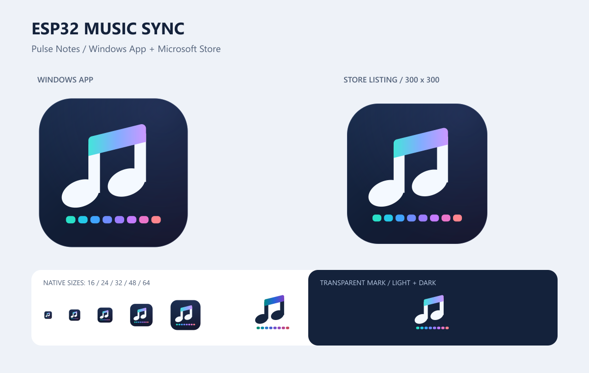

# 圖示設計：Pulse Notes

「音符＋8 格彩色 LED」代表以播放音訊控制 8 顆 WS2812。深藍底在 Windows 淺色／深色介面都能辨識；白色音符保留小尺寸對比，青色至紫色漸層及八格光點呼應動態燈條。圖示不包含文字、ESP32／Microsoft／YouTube 商標或第三方圖庫素材。

原稿為本專案直接繪製的 SVG 幾何，不需字型、外部圖片或 AI 點陣生成服務。App 執行時只載入 ICO／PNG，SVG 與產圖工具不會加入執行時相依套件。



## 交付檔案

| 用途 | 位置與尺寸 |
| --- | --- |
| Windows EXE／通知區 | `../Assets/AppIcon.ico`，內含16／20／24／32／40／48／64／128／256px，32-bit alpha |
| Store 商品頁 App tile | `../StoreListing/StoreListingIcon-300.png`，300×300 PNG |
| 高解析 Store 原稿 | `../StoreListing/StoreListingIcon-1024.png`，1024×1024 PNG，非Store必填尺寸 |
| 完整圖示向量 | `music-sync-icon.svg` |
| 深色表面透明標誌 | `music-sync-mark.svg` |
| 淺色表面透明標誌 | `music-sync-mark-light.svg` |
| 寬磚向量 | `music-sync-wide.svg`，由標誌原稿組合 |
| PNG 設計原稿 | `music-sync-icon-1024.png` |
| 設計與原生尺寸預覽 | `icon-preview.png` |
| 所有輸出尺寸／雜湊 | `assets-manifest.json` |

MSIX `Assets/` 共有66份PNG和1份ICO：StoreLogo、Square44x44Logo、Square150x150Logo、Wide310x150Logo的基礎檔與scale 100／125／150／200／400，以及14個targetsize的default／unplated／lightunplated版本。StoreLogo.scale-125為63×63，以向上取整處理50×1.25。

透明unplated檔依背景使用白色或深藍音符。小尺寸以SVG直接渲染，ICO每個尺寸皆獨立生成；避免只放單張256px而由Windows任意縮小。

## 重新輸出設計

一般程式建置／MSIX封裝直接使用已產生的PNG／ICO，不需要Node或sharp。修改SVG設計後才需設計工具：

```powershell
# 在儲存庫根目錄執行，sharp為設計階段的相依套件。
# 若sharp沒有安裝在Node預設查找位置，可指定既有node_modules目錄：
$env:MUSIC_SYNC_SHARP_MODULE_DIR = '<node_modules完整路徑>'
node .\02-windows-music-sync\scripts\render-brand-assets.cjs
```

渲染腳本從SVG產生70項交付素材並核對PNG尺寸／alpha，ICO為9種尺寸。`music-sync-wide.svg`、預覽與manifest亦會重新產生。設計工具不處理音訊，也不連接燈條。

MSIX封裝時會重建`resources.pri`，讓Windows依縮放比例、目標尺寸和主題選擇正確資產；資產複製、MakePri或MakeAppx失敗均會停止建置。

## 官方規格

- [App icon construction](https://learn.microsoft.com/en-us/windows/apps/design/iconography/app-icon-construction)：Windows的targetsize／unplated版本。
- [Store screenshots and images](https://learn.microsoft.com/en-us/windows/apps/publish/publish-your-app/msix/screenshots-and-images#11-app-tile-icon-300-x-300-pixels)：MSIX商品頁的300×300 App tile。
- [MakePri package resource index](https://learn.microsoft.com/en-us/windows/msix/desktop/desktop-to-uwp-manual-conversion#generate-a-package-resource-index-pri-file-using-makepri)：手動封裝的資源索引。

圖示輸出與MSIX驗證不等於Store已完成上傳、WACK或認證。
