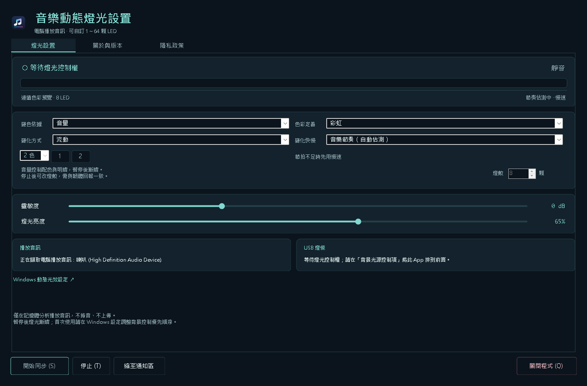

# ESP32-S3 USB 燈條與 Windows 音樂動態光效

使用 Waveshare ESP32-S3 N32R16 與 WS2812，透過 USB HID LampArray 接受 Windows 11「動態光效」控制。搭配本專案的 **「音樂動態燈光設置」App**，可分析電腦播放的音訊，讓燈條隨 YouTube 等播放內容變化。

目前 App 送審版本為 **0.3.1.0**，支援自訂 **1～64 顆，預設 8 顆**，新增內建離線「隱私政策」分頁。Microsoft Store 套件已通過後台 `Validated` 檢查並成功提交，目前預先處理中；已設定通過認證後立即發布，**尚未認證通過或公開發布**。實體原型仍為 8 顆、GPIO4 直連及 USB 供電，沒有重刷 ESP32。以下狀態依 2026-10-21 的程式與後台讀回整理。

[隱私政策（公開閱讀）](https://github.com/chiangyih/esp32-s3-windows-dynamic-lighting/blob/main/02-windows-music-sync/Packaging/privacy-policy.zh-TW.md)：與 App 內建離線政策共用同一份來源。

| 項目 | 目前設定 |
| --- | --- |
| App | 音樂動態燈光設置 0.3.1.0，已提交 Store 認證 |
| 開發方式 | C# 10、.NET 10、WinForms，x64 |
| Windows | Windows 11；套件最低 23H2，執行時另檢查 LampArray 控制權 API；目前以 24H2 測試 |
| 裝置 | 本專案 `ESP32-S3 USB Light Strip`，VID 303A／PID 1001 |
| 燈數 | 1～64 顆；App 設定須與韌體回報相同 |
| 原型硬體 | Waveshare ESP32-S3-DEV-KIT-NXRX N32R16、8 顆 WS2812 |
| 供電／資料 | 同一條 USB 傳輸及供電，GPIO4 輸出燈條資料 |
| Store | 已提交；Publishing Status 步驟 2/4、預先處理中，通過認證後自動發布；尚未認證通過或公開發布，WACK 未跑 |

**64 顆目前只有編譯、程式與預覽驗證，尚未完成實體燈條及 USB 耗電驗證。** 使用者最新確認仍接8顆；64顆測試工具與所需量測條件已整理於[64顆USB實測](docs/64顆USB實測.md)。增加燈數前請先閱讀[自訂燈數與 USB 供電](docs/自訂燈數與USB供電.md)。

## App 畫面與功能



| 選項 | 功能 |
| --- | --- |
| 燈數 | 停止同步並完成清理後，可設定 1～64 顆；正常關閉後保存、下次還原 |
| 變色依據 | 音量、聲頻的低／中／高頻能量分布、高低音比例 |
| 色彩定義 | Windows 佈景主題輔色、彩虹、自訂 2～4 種顏色 |
| 變化方式 | 呼吸、流動、單顆依序 |
| 變化快慢 | 音樂節奏自動估測、手動曲風快／中／慢、自訂每秒 0.1～4 循環 |
| 預覽 | 整條連續漸層，依設定燈數顯示色彩分布；1 顆顯示單色 |
| 視窗 | 蒂芬妮藍與深藍配色、燈光設置／關於與版本／隱私政策三分頁、通知區執行、明確關閉按鈕 |

聲頻分析是粗頻帶能量分布，沒有進行 FFT、精確音高或樂器辨識。節奏為起音間隔估測，可能半拍／倍拍；資訊不足時使用慢速。「曲風快慢」是手動預設，不會自動辨識曲風。

單顆依序以走完目前全部燈數為一循環，會按更新間隔限制速度，確保逐顆前進。約 30 fps 時，8 顆上限約每秒 3.75 循環、64 顆約每秒 0.47 循環，慢幀時更低。所有模式仍由音量控制明暗，暫停播放後漸暗。

## 快速使用

1. 接上已燒錄本專案韌體、接線完成的 ESP32-S3。現有原型使用 **8 顆**，App 燈數也請保留 8。
2. 在「Windows 設定 → 個人化 → 動態光效」啟用裝置控制，確認出現 `ESP32-S3 USB Light Strip`。
3. 開啟已安裝的「音樂動態燈光設置」。如需變更燈數，先按「停止」、等待清理完成，再修改「燈數」。
4. 在 Windows「背景光源控制項」將本 App 排到前面；前景相容程式也可能影響控制權。App 內有「Windows 動態光效設定」連結。
5. 播放 YouTube，按「開始同步」，再選擇變色依據、配色、變化方式與速度。**不必把 Windows 內建效果改成「音效」。**
6. 暫停音樂後燈光會漸暗；按「停止」會停止分析與控制，Windows 可能恢復原先效果。「縮至通知區」繼續同步；「關閉程式」、視窗 X 或通知區關閉則清理資源並退出。

需搭配支援 Windows 動態光效的硬體；目前 App 僅控制唯一符合本專案識別的裝置。預覽有變化不代表取得實體控制權，請同時查看「USB 燈條」狀態。

音訊來源為**預設多媒體播放裝置的混音**，可能包含其他 App；YouTube 若指定至其他輸出，請改用預設輸出。程式只在記憶體分析，不開啟麥克風、不保存錄音、不上傳音訊。「隱私政策」分頁使用隨 App 封裝的同一份[政策文字](02-windows-music-sync/Packaging/privacy-policy.zh-TW.md)，發行者 Tseng，可離線捲動閱讀，不開啟外部網頁。完整操作見 [App README](02-windows-music-sync/README.md)。

## 自訂燈數與 USB 供電

App 的燈數設定不會改寫 ESP32，也不會自動偵測實際 WS2812 顆數。更換燈條時需依序完成：

1. 確認實體燈數、接線及 USB 供電能力。
2. 用相同燈數建置並燒錄韌體，讓 LampArray 回報正確數量。
3. 停止 App 同步，將燈數設為相同值，再開始同步。

例如裝置回報 8 顆、App 設為 64 顆時，會顯示數量不符並拒絕送色。裝置回報的是韌體設定，不能用較小宣告值規避實體燈條的耗電。

| 韌體參數 | 預設與限制 |
| --- | --- |
| `CONFIG_LAMP_COUNT` | 預設 8，允許 1～64 |
| `CONFIG_LED_BUDGET_MA` | 預設 50 mA，為 LED 支路的軟體估算預算 |
| 靜態電流模型 | 每顆 1 mA；預算必須嚴格大於靜態總和 |
| 額外亮度上限 | RGB 每通道最高 24/255，再按電流模型縮放 |
| 原生 USB 宣告 | 100 mA，不代表整板及 USB hub 的實際總耗電 |

保持 50 mA 預算時，**50～64 顆會被編譯檢查拒絕**。64 顆在此模型下至少需要 65 mA，必須明確指定 `-LedBudgetMa`；已完成的 64 顆／80 mA 建置只是軟體測試，不能視為 USB 供電足夠。

軟體縮放無法取代實際電流量測或硬體限流。直連模式下全黑仍有靜態耗電；開發板、hub、UART 晶片與燈條合計負載也需核對。詳細建置範例與供電限制見[自訂燈數與 USB 供電](docs/自訂燈數與USB供電.md)。

## 硬體與接線

| ESP32-S3 | WS2812 |
| --- | --- |
| 5V | +5V |
| GND | GND，共地 |
| GPIO4 | 建議串聯 330Ω 後接第一顆 DIN |

目前 `UsePowerSwitch = false`，先不使用 TPS2553 或 74AHCT125，GPIO9／GPIO10 不需接線。省略電平轉換後，3.3V 資料訊號是否可靠取決於實際 LED 版本；限亮無法改善邏輯電平裕量。請配合[直連接線說明](docs/直連接線.md)與[接線圖](docs/circuit-direct.svg)。

板上 Type-C 經 USB hub 分別連到 CH343 UART 與 ESP32-S3 原生 USB；UART 用於燒錄，原生 USB 提供 HID LampArray。GPIO19／20 保留給 USB。本案不使用有記憶體／電壓限制的其他接腳；板型與拓撲讀回見[驗證紀錄](docs/驗證紀錄.md)。

開發板照片為[61282_0.jpg](圖片/61282_0.jpg)、[61283_0.jpg](圖片/61283_0.jpg)、[61284_0.jpg](圖片/61284_0.jpg)；8 顆燈條照片為[61285.jpg](圖片/61285.jpg)。包含 TPS2553 與 74AHCT125 的[備選電路](docs/電路與供電.md)及[圖檔](docs/circuit.svg)保留供日後組裝使用。

## 韌體建置

第一個程式集中於 `01-8_ws2812/`，主程式為 [01-8_ws2812.ino](01-8_ws2812/01-8_ws2812.ino)。建置基準為 Arduino ESP32 core **3.1.1**，USB HID 使用 TinyUSB，WS2812 使用硬體 RMT，不需額外 LED 函式庫。

在儲存庫根目錄執行，以下只建置、不燒錄：

```powershell
# 目前8顆原型，保留50mA預算。
& .\scripts\build.ps1 -Cli 'C:\Program Files\Arduino CLI\arduino-cli.exe' `
    -LampCount 8 -OutputDirectory '.\build\count-8'

# 16顆建置範例，仍維持50mA預算；使用前須確認實體與供電。
& .\scripts\build.ps1 -Cli 'C:\Program Files\Arduino CLI\arduino-cli.exe' `
    -LampCount 16 -OutputDirectory '.\build\count-16'
```

每個輸出目錄含 `firmware-build-report.json`，記錄燈數、電流預算及產物雜湊。未指定燈數時保留 8 顆；`LampPitchUm`／`StripWidthUm` 可在 [Config.h](01-8_ws2812/Config.h) 依實際燈條修改。

腳本使用 ESP32S3 Dev Module、USB-OTG (TinyUSB)、USB CDC On Boot 關閉、CPU 80 MHz、OPI Flash 32 MB、OPI PSRAM 與對應分割配置。燒錄前仍須核對實板；CH343 **COM3** 是先前驗證的埠號，換電腦或重新連接後應重新辨識。

韌體沿用 Microsoft [ArduinoHidForWindows](https://github.com/microsoft/ArduinoHidForWindows) 的 LampArray **報告描述元**與 [MIT 授權](01-8_ws2812/LICENSE-Microsoft.txt)；協定解析、ESP32 USB、RMT 與限亮由本專案實作。YouTube 音樂同步由 Windows App 提供，沒有把完整 Microsoft Arduino 函式庫移植到 ESP32-S3。USB VID／PID 仍為開發識別，正式硬體產品需另行處理合法識別碼。

## App 建置、封裝與測試

本機建置基準為 .NET SDK **10.0.402**。C# 語法固定為 10.0，執行階段使用 .NET 10；MSIX 自包含執行階段，一般使用者不需另裝 .NET。封裝另需 Windows SDK 的 MakePri／MakeAppx。

在儲存庫根目錄執行：

```powershell
# App建置及純程式檢查。
dotnet build .\02-windows-music-sync\MusicSync.csproj -c Release -p:Platform=x64
dotnet run --project .\02-windows-music-sync\tests\TestRunner.csproj -c Release

# 韌體PC協定／電流模型測試；需本機C++編譯工具，不會寫入ESP32。
& .\tests\run-tests.ps1

# 產生開發用MSIX與layout。
& .\02-windows-music-sync\scripts\build-package.ps1
```

已有 Developer Mode 的開發環境可依[封裝文件](02-windows-music-sync/Packaging/README.md)註冊產生的 layout，再以套件身分啟動。正在註冊使用的 layout 目錄必須保留；腳本不會自行啟用 Developer Mode 或變更機器憑證信任。未封裝 EXE 適合開發診斷，背景控制應使用封裝版。

App 使用 Windows WASAPI 與 LampArray API，沒有 WebView、Windows App SDK、NAudio 或新增音訊套件。分析與燈效重用緩衝，正常送色約 30 fps、靜音後降至 8 Hz；相同畫面不重送，預覽每 250 ms 更新，隱藏時不重繪。CPU／記憶體數據需依實際版本、音訊與控制權狀態量測。

## 已驗證與待驗證

以下為已保存的驗證結果，這次 README 更新沒有重新測試硬體：

| 範圍 | 結果與界線 |
| --- | --- |
| 8 顆實體原型 | 先前已燒錄，Windows 設定頁辨識成功；使用者確認 8 顆紅／綠／藍切換，以及舊版 App 三種效果、暫停漸暗 |
| 0.3.1.0 程式與介面 | 本輪重跑 148 項純程式檢查通過；三頁真實截圖均為 1366×900 且目視確認，測試 PID 消失、清理錯誤為空，未回讀退出碼 |
| 0.3.1.0 送審套件 | 正式產品身分已與 Partner Center 讀回核對；使用者手動上傳後，後台顯示 `Validated`、X64、Windows.Desktop、最低 10.0.22631.0 |
| 0.3.0.0 程式與預覽 | 148 項純程式、6 項原生預覽檢查通過 |
| 0.3.0.0 韌體 | 26 項 PC 協定／限流、8 項設定邊界檢查通過；8／50 mA 與 64／80 mA 完整建置均 0 warnings，未燒錄 |
| 0.3.0.0 燈數比對 | 封裝 API 回報 8 顆；App 設為 1 或 64 顆均拒絕送色，0 幀；保存／重啟還原及停止／重啟通過 |
| 0.3.0.0 退出 | 按鈕、啟動途中、通知區及 WM_CLOSE 四條路徑通過，程序退出且清理錯誤為空 |
| 0.3.0.0 實體音樂送色 | 當次相符 8 顆測試仍等待 Windows 控制權、0 幀；沒有新增此版本的實體音樂驗收 |
| USB／64 顆實體 | 電流、可用亮度、DIN 波形、電壓裕量、長時間負載、睡眠／喚醒及 USB 重插仍待驗證 |
| Store | Submission 1 已提交，後台概觀顯示認證中；細部進度為預先處理中，認證及發布尚未啟動。WACK 仍未執行 |

0.3.1.0 上架準備見 [StoreSubmission 索引](02-windows-music-sync/Packaging/StoreSubmission/README.md)；[0.3.0.0 驗證摘要](docs/verification/2026-10-21/lamp-counts/0.3.0/verification-summary.json)與舊版實物驗收保留原版本。曾出現的退出阻塞及 0.2.1 修正後實際送色／清理證據，保留於 [handoff.md](handoff.md) 與[驗證目錄](docs/verification/README.md)。編譯、API 讀回與使用者實物觀察各自記錄，不互相取代。

2026-10-21 已完成產品 `9NKRN1KCR738` 的 Submission 1（`1152921505702190045`）提交。政策與支援網址、繁中說明、7 項功能、7 組搜尋字詞、三張截圖、商品圖示及認證測試備註均已保存。後台沿用既存 IARC 分級，沒有重新代答或新增同意；價格與發行設定讀回為免費、240 個市場、公開可搜尋，通過認證後立即發布。Publishing Status 顯示步驟 2/4：提交完成、預先處理進行中，認證及發布尚未啟動。證據見[提交狀態](docs/verification/2026-10-21/store-submission/0.3.1/submission-status.json)及[後台畫面](docs/verification/2026-10-21/store-submission/0.3.1/submission-in-certification.jpg)。

公開 GitHub 政策與 App 內建來源文字一致，無需另外建立 Pages 或重建 MSIX。先前瀏覽器初始化故障及自動上傳錯誤保留於 [handoff.md](handoff.md)，已不是本輪目前的阻擋；本次沒有完成 WACK、乾淨機安裝或 64 顆實體 USB 測試。

## 專案目錄與文件

| 路徑 | 內容 |
| --- | --- |
| [01-8_ws2812](01-8_ws2812/) | ESP32-S3 韌體，預設 8 顆、可建置 1～64 顆 |
| [02-windows-music-sync](02-windows-music-sync/README.md) | Windows App、操作與開發說明 |
| [scripts](scripts/)／[tests](tests/) | 韌體建置、LampArray 診斷與 PC 測試 |
| [docs](docs/) | 接線、供電、設計與驗證證據 |
| [圖片](圖片/) | 使用者提供的開發板及燈條照片 |
| [handoff.md](handoff.md) | 依日期保留的已驗證事項、歷史及待辦 |
| [Store 封裝文件](02-windows-music-sync/Packaging/README.md) | MSIX、開發安裝、Store 提交準備 |
| [App／Store 圖示](02-windows-music-sync/Packaging/Branding/README.md) | 可編輯原稿、Windows 與商品頁圖示 |

GitHub 儲存庫：[chiangyih/esp32-s3-windows-dynamic-lighting](https://github.com/chiangyih/esp32-s3-windows-dynamic-lighting)，分支 `main`。原始碼、照片與精簡證據納入 Git；本機 `build/`、App `artifacts/` 等產物由 `.gitignore` 排除，保留本機正在使用的註冊目錄。
