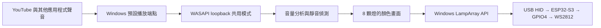

# Windows 播放音訊與 8 顆燈條同步：設計評估

> 狀態更新（2026-10-21）：使用者其後授權正式實作，C# 10／.NET 10 程式已新增至 [02-windows-music-sync](../02-windows-music-sync/README.md)。以下保留先前評估的歷史與驗證規劃；最新完成項目及實板狀態以 [handoff.md](../handoff.md) 最新追加紀錄為準。

日期：2026-10-21（Asia/Taipei）。使用者指定**先評估並更新設計文件**；本輪不新增 Windows 程式、不安裝套件、不改 Windows 設定，也不修改或燒錄 ESP32-S3 韌體。

## 目標與已驗證基礎

現有 ESP32-S3 經 USB HID LampArray 讓 Windows 11 原生「動態光效」辨識 8 顆 WS2812。使用者已目視確認原生純色可讓 8 顆隨紅、綠、藍切換；目前接線是 GPIO4、板上 5V、GND，沒有 TPS2553 或 74AHCT125。設定頁的「音效」在暫停 YouTube 後仍自行流動／變色，不能視為音樂同步。

目標是在 **YouTube 位於瀏覽器前景**時，另由 Windows 應用程式分析電腦正在播放的音訊，透過同一個 LampArray 裝置更新 8 顆燈。原生動態光效仍負責裝置枚舉、控制權與使用者優先順序；韌體仍只接收燈色，不擷取音訊。

## 建議實作

| 部分 | 方案與原因 |
| --- | --- |
| 擷取範圍 | 選取 Windows 預設播放端點（`eRender`，音樂用途可用 `eMultimedia`），以 WASAPI **shared-mode loopback** 擷取該端點的系統混音。它會包含 YouTube 及其他應用程式在此端點播放的聲音；不宣稱只擷取 YouTube，也不需要麥克風或硬體 Stereo Mix。若使用者將聲音切到另一輸出裝置，須重新選取端點並開啟擷取。 |
| 擷取介面 | 以 `IMMDeviceEnumerator` 取得端點；`IAudioClient::GetMixFormat` 讀取實際的 `WAVEFORMATEX/WAVEFORMATEXTENSIBLE`（可能是浮點或整數 PCM），不可假設固定 16-bit stereo；`Initialize` 使用 `AUDCLNT_STREAMFLAGS_LOOPBACK`，再以 `IAudioCaptureClient` 逐包 `GetBuffer/ReleaseBuffer`。Windows 11 可使用事件驅動方式。`AUDCLNT_BUFFERFLAGS_SILENT` 當成靜音；端點失效時停止並重建擷取。 |
| 第一版燈效 | 每約 20–50 ms 計算多聲道混音的 RMS 音量；加入噪聲門檻、音量正規化上下限，以及較快的上升／較慢的下降平滑。映射成 0–8 格音量條，可用固定色彩漸層；暫停、靜音或長時間沒有新封包時逐漸回到全黑。先讓「播放會變、暫停會熄」可測，後續再評估 8 頻帶 FFT。這些時間與門檻是**設計初值**，不是實測定值。 |
| 燈條輸出 | 透過 `LampArray.GetDeviceSelector` 枚舉，核對產品名、VID `303A`、PID `1001` 及 `LampCount=8`，以 `FromIdAsync` 開啟；每次送 8 顆完整色彩至 `SetColorsForIndices`。建議約 30 fps，並遵守實際讀回的 `MinUpdateInterval`（先前為 16.667 ms）。`IsAvailable=false`、停用或斷線時停止送色；以 `AvailabilityChanged`、`DeviceWatcher` 處理控制權及 USB 重插。不得以原始 HID 強行繞過 Windows 優先順序。 |
| Windows 應用與封裝 | 建議做獨立的 Windows 桌面應用（例如 .NET WinForms）並以 **MSIX** 提供 package identity，在 manifest 宣告 `com.microsoft.windows.lighting` AppExtension。這是 Microsoft 對背景 ambient LampArray 控制的要求；只有前景 WinForms 視窗／現有短時測試腳本，不能保證使用者切到瀏覽器後仍可送色。安裝後由使用者在「設定 → 個人化 → 動態光效 → 背景光源控制項」調整優先順序。MSIX 建置、簽署、安裝與背景控制尚未執行或驗證。 |

擷取對象是播放端點的混音；Microsoft 文件指出此混音可能包含其他應用程式、甚至其他登入工作階段的聲音。介面應明示「電腦播放音訊」，並預設僅在記憶體中計算燈效，不建立錄音檔或上傳音訊。應用退出或失去控制權時，Windows 可能恢復原先設定的燈效，不保證燈條保持全黑。

目前 `scripts/test-lamparray.ps1` 只供短時間枚舉與前景控制診斷；它沒有 WASAPI 擷取，也不是可持續運作的背景應用。第一個 ESP32 韌體仍放在 `01-8_ws2812/`；日後若實作 Windows 程式，應放獨立目錄，避免與韌體混放。既有韌體將輸出每色限制為最高 24/255，並依 50 mA 模型再縮放；這是軟體估算，不是整板 USB 電流量測。前次 HID 規範對照發現 `*LevelCount=255` 與實際亮度階數不一致，屬另一個待處理項目，不是音訊同步失效的原因。

Microsoft 的 [ArduinoHidForWindows](https://github.com/microsoft/ArduinoHidForWindows) 是**裝置端 HID 參考函式庫**，沒有 WASAPI 或 Windows 音訊分析。現行 ESP32-S3 韌體僅沿用其 LampArray 描述元；[完整套件](https://github.com/microsoft/ArduinoHidForWindows/blob/deb7e5e20d96bab5571ee2629d634375002f5513/library.properties)標示 `architectures=samd`，USB 基底類別依賴 `PluggableUSB`，不能直接安裝到目前的 ESP32 TinyUSB 專案。即使日後移植 LampArray 類別，Windows 播放音訊同步仍需要上述獨立的 WASAPI + Windows LampArray 應用。移植評估記於 [handoff.md](../handoff.md)。

## 驗證順序與通過條件

1. **音訊端**：用已知可播放的音源，確認程式讀到非零音量；暫停／靜音後音量回到零。不保存原始聲音、錄音檔或音訊片段，只在記憶體分析；診斷紀錄僅保留必要的狀態與統計值。
2. **控制權**：封裝並安裝應用後，確認它出現在 Windows「背景光源控制項」，且使用者將它排入可控制位置；瀏覽器位於前景時檢查 `LampArray.IsAvailable`，只有可用時送色。若不可用，記錄原因並讓 Windows 原有效果接管。
3. **實體燈條**：觀察 8 顆在播放時隨音量變化、暫停後漸暗；再測輸出裝置切換、USB 重插、應用退出及其他程式搶控制權。API 呼叫成功與音量數值變化都不能取代使用者實物觀察。
4. **電氣邊界**：保留現行韌體限亮；音效流暢或燈色變化不代表 USB 供電、DIN 訊號或整板耗電已合規，仍須分別量測。

## 官方依據與限制

- [Microsoft：WASAPI loopback](https://learn.microsoft.com/en-us/windows/win32/coreaudio/loopback-recording)：擷取播放端點混音，只支援 shared-mode；某些受保護內容可能無法擷取。
- [Microsoft：IAudioClient::GetMixFormat](https://learn.microsoft.com/en-us/windows/win32/api/audioclient/nf-audioclient-iaudioclient-getmixformat)、[IAudioCaptureClient::GetBuffer](https://learn.microsoft.com/en-us/windows/win32/api/audioclient/nf-audioclient-iaudiocaptureclient-getbuffer)：確認格式、靜音旗標及封包讀取規則。
- [Microsoft：Dynamic lighting](https://learn.microsoft.com/en-us/windows/apps/develop/devices-sensors/lighting-dynamic-lamparray)：前景／背景控制、AppExtension 與 package identity 要求。
- [Microsoft LampArray sample](https://github.com/microsoft/Windows-universal-samples/blob/main/Samples/LampArray/README.md) 與 [範例 manifest](https://github.com/microsoft/Windows-universal-samples/blob/main/Samples/LampArray/cs/Package.appxmanifest)：DeviceWatcher、LampArray 與背景燈效宣告的參考，不表示目前專案已安裝或可直接編譯此範例。
- [Microsoft：封裝 .NET 桌面應用](https://learn.microsoft.com/en-us/windows/apps/desktop/modernize/dotnet/package-app)：WinForms/WPF 可搭配 Windows Application Packaging Project 建立 MSIX。

本輪僅完成文件設計；**音訊擷取、音效映射、MSIX 與實板音樂同步皆尚未實作或測試**。

## 2026-10-21後續實作更新：0.2.0.0

本節追加使用者其後授權實作及擴充的結果；前述「僅評估／尚未實作」保留為原始設計歷史。目前Windows程式位於`02-windows-music-sync/`，以C#10語言、.NET10、WinForms、WASAPI COM與Windows LampArray實作，不增加NAudio、FFT、WebView或其他執行時函式庫。0.1.2.0曾獲使用者實物確認：「燈會隨音樂變化，暫停後漸暗」；新版功能與控制權須分別驗證。

### 音訊與燈效

WASAPI沿用預設多媒體播放端點的共用混音，PCM／浮點各聲道獨立計算能量，避免反相抵銷。新增可重用的一階濾波與能量／起音間隔統計，粗分低、中、高頻；250Hz與2500Hz是濾波轉折參數，頻帶會重疊，不能當作精確頻譜或音高測量。分析只保留濾波、能量與時間統計，不建立音訊檔案或上傳聲音。

| 使用者選擇 | 0.2.0.0實作與界線 |
| --- | --- |
| 色彩變化依據 | 音量、粗低／中／高頻能量分布、高低音能量比例三種。各模式仍由音量控制亮暗，過期音訊或靜音時漸暗。 |
| 色彩定義 | 目前Windows輔色及同色系深淺、彩虹、2～4種自訂顏色插值；追蹤Windows輔色變更。 |
| 變化方式 | 整條呼吸、沿條流動、8顆單顆依序。預覽改成連續無段光條，實體硬體仍是8顆。 |
| 音樂節奏速度 | 由音訊起音間隔估測BPM，足夠一致時用於動畫速度；資訊不足時顯示估測中，使用每秒0.5循環。可能有半拍／倍拍差異，不宣稱精準節拍同步。 |
| 曲風快慢 | 手動選慢／中／快，不分析或分類曲風。 |
| 自訂速度 | 目標每秒0.1～4循環。單顆依序依實際更新間隔限制每幀步進，確保按順序走過8顆；約30fps時上限略低於每秒3.75循環，慢幀時更低。 |

燈效工作重用8顆色彩緩衝，正常約30fps，靜音後降為8Hz，略過相同畫面並遵守裝置`MinUpdateInterval`。只在Windows授予`IsAvailable`時送色，不使用raw HID或變更控制權登錄值。設定以不可變快照交給工作執行緒；一般使用者選擇於正常關閉時寫入本機JSON，下次還原，診斷覆寫不存回日常設定。

### 介面與退出

視窗採蒂芬妮藍、深藍底與低彩度文字，保留原生Windows視窗行為；不加常駐動畫計時器。連續光條預覽沿用每250ms更新，隱藏至通知區時不重繪。新增固定可見的「關閉程式」按鈕，與「停止同步」及「縮至通知區」分開。

關閉按鈕、視窗X／Alt+F4與通知區退出共用清理流程：取消工作、停止WASAPI、釋放音訊COM與等待物件、結束送色及LampArray探索、移除事件、釋放通知區圖示／選單／計時器／字型和視窗，最後結束程序。診斷報告分列工作狀態、清理錯誤與視窗資源；外部測試另確認原PID消失，不能只由`Dispose`旗標推定程序已退出。

### 0.2.0.0早期檢查與後續問題

0.2.0.0已Release建置（0 warnings）並封裝、在本機開發註冊。整合檢查 **115項** 通過：17項既有核心、26項音訊解碼、17項頻帶／節奏特徵與55項燈效；另四種正常退出路徑與六項UI選擇診斷通過。退出檢查當時未取得燈光控制權，沒有涵蓋其後發現的原生回呼互鎖，不能用這份結果證明有控制權時退出可靠。

早期短時封裝背景測試讀到`IsAvailable=false`／`SentFrames=0`；其後調整控制權，使用者針對0.2.0.0回報「**三種效果都有反應，暫停後漸暗**」。此為新版三種動畫的使用者實物觀察，早期零送色報告保留為調整前歷史，不再作為目前燈效失敗的依據。0.1.2.0的播放／暫停實物驗收另保留歷史。

取得燈光控制權後，實機另發現停止／關閉卡住。執行緒堆疊顯示送色在持有互斥鎖時進入原生LampArray，控制權回呼等候同一把鎖，UI停止也等候鎖；形成原生回呼與應用鎖互等。嘗試一般關閉未能退出，該次程序最終須終止，不能列作正常清理通過。這個問題與使用者已看到燈效反應是不同驗證項目。

本輪未修改或燒錄ESP32韌體，GPIO4／5V／GND直連與原有限亮保留。WACK、正式Store產品身分、乾淨機／Store安裝、認證及發布仍待完成；新增功能與開發註冊不改變這些狀態。

### 2026-10-21後續修正版：0.2.1.0

來源以0.2.1.0作為上述停止／退出問題的修正版本：將LampArray原生呼叫移出應用互斥鎖，避免原生回呼持續等候送色鎖；停止與釋放改為非同步，避免UI執行緒同步等候原生資源。原有115項計算／特徵／燈效檢查與未取得控制權時的退出結果維持0.2.0.0歷史，不搬用為修正版驗證。

0.2.1.0已重新建置（0警告）、通過115項計算檢查、四種正常退出、MakePri／MakeAppx驗證及開發註冊。另在控制權可用與實際播放合成120BPM脈衝時測試停止／重新開始，送出211幀；停播後歸零，最後約125ms正常清理退出、原PID消失，音訊／繪製／搜尋／清理工作及錯誤陣列均為空。這是乾淨合成訊號與API生命週期驗證；使用者三種實物燈效確認來源仍為0.2.0，沒有冒稱任意曲目節拍精度。實測與封裝雜湊見[交接文件](../handoff.md)及`verification/2026-10-21/music-effects/0.2.1/`；Store驗證狀態不變。
