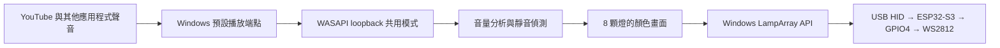

# Windows 播放音訊與 8 顆燈條同步：設計評估

> 狀態更新（2026-10-21）：使用者其後授權正式實作，C# 10／.NET 10 程式已新增至 [02-windows-music-sync](../02-windows-music-sync/README.md)。以下保留先前評估的歷史與驗證規劃；最新完成項目及實板狀態以 [handoff.md](../handoff.md) 最新追加紀錄為準。

日期：2026-10-21（Asia/Taipei）。使用者指定**先評估並更新設計文件**；本輪不新增 Windows 程式、不安裝套件、不改 Windows 設定，也不修改或燒錄 ESP32-S3 韌體。

## 目標與已驗證基礎

現有 ESP32-S3 經 USB HID LampArray 讓 Windows 11 原生「動態光效」辨識 8 顆 WS2812。使用者已目視確認原生純色可讓 8 顆隨紅、綠、藍切換；目前接線是 GPIO4、板上 5V、GND，沒有 TPS2553 或 74AHCT125。設定頁的「音效」在暫停 YouTube 後仍自行流動／變色，不能視為音樂同步。

目標是在 **YouTube 位於瀏覽器前景**時，另由 Windows 應用程式分析電腦正在播放的音訊，透過同一個 LampArray 裝置更新 8 顆燈。原生動態光效仍負責裝置枚舉、控制權與使用者優先順序；韌體仍只接收燈色，不擷取音訊。

## 建議實作

| 部分 | 方案與原因 |
| --- | --- |
| 擷取範圍 | 選取 Windows 預設播放端點（`eRender`，音樂用途可用 `eMultimedia`），以 WASAPI **shared-mode loopback** 擷取該端點的系統混音。它會包含 YouTube 及其他應用程式在此端點播放的聲音；不宣稱只擷取 YouTube，也不需要麥克風或硬體 Stereo Mix。若使用者將聲音切到另一輸出裝置，須重新選取端點並開啟擷取。 |
| 擷取介面 | 以 `IMMDeviceEnumerator` 取得端點；`IAudioClient::GetMixFormat` 讀取實際的 `WAVEFORMATEX/WAVEFORMATEXTENSIBLE`（可能是浮點或整數 PCM），不可假設固定 16-bit stereo；`Initialize` 使用 `AUDCLNT_STREAMFLAGS_LOOPBACK`，再以 `IAudioCaptureClient` 逐包 `GetBuffer/ReleaseBuffer`。Windows 11 可使用事件驅動方式。`AUDCLNT_BUFFERFLAGS_SILENT` 當成靜音；端點失效時停止並重建擷取。 |
| 第一版燈效 | 每約 20–50 ms 計算多聲道混音的 RMS 音量；加入噪聲門檻、音量正規化上下限，以及較快的上升／較慢的下降平滑。映射成 0–8 格音量條，可用固定色彩漸層；暫停、靜音或長時間沒有新封包時逐漸回到全黑。先讓「播放會變、暫停會熄」可測，後續再評估 8 頻帶 FFT。這些時間與門檻是**設計初值**，不是實測定值。 |
| 燈條輸出 | 透過 `LampArray.GetDeviceSelector` 枚舉，核對產品名、VID `303A`、PID `1001` 及 `LampCount=8`，以 `FromIdAsync` 開啟；每次送 8 顆完整色彩至 `SetColorsForIndices`。建議約 30 fps，並遵守實際讀回的 `MinUpdateInterval`（先前為 16.667 ms）。`IsAvailable=false`、停用或斷線時停止送色；以 `AvailabilityChanged`、`DeviceWatcher` 處理控制權及 USB 重插。不得以原始 HID 強行繞過 Windows 優先順序。 |
| Windows 應用與封裝 | 建議做獨立的 Windows 桌面應用（例如 .NET WinForms）並以 **MSIX** 提供 package identity，在 manifest 宣告 `com.microsoft.windows.lighting` AppExtension。這是 Microsoft 對背景 ambient LampArray 控制的要求；只有前景 WinForms 視窗／現有短時測試腳本，不能保證使用者切到瀏覽器後仍可送色。安裝後由使用者在「設定 → 個人化 → 動態光效 → 背景光源控制項」調整優先順序。MSIX 建置、簽署、安裝與背景控制尚未執行或驗證。 |

擷取對象是播放端點的混音；Microsoft 文件指出此混音可能包含其他應用程式、甚至其他登入工作階段的聲音。介面應明示「電腦播放音訊」，並預設僅在記憶體中計算燈效，不建立錄音檔或上傳音訊。應用退出或失去控制權時，Windows 可能恢復原先設定的燈效，不保證燈條保持全黑。

目前 `scripts/test-lamparray.ps1` 只供短時間枚舉與前景控制診斷；它沒有 WASAPI 擷取，也不是可持續運作的背景應用。第一個 ESP32 韌體仍放在 `01-8_ws2812/`；日後若實作 Windows 程式，應放獨立目錄，避免與韌體混放。既有韌體將輸出每色限制為最高 24/255，並依 50 mA 模型再縮放；這是軟體估算，不是整板 USB 電流量測。前次 HID 規範對照發現 `*LevelCount=255` 與實際亮度階數不一致，屬另一個待處理項目，不是音訊同步失效的原因。

Microsoft 的 [ArduinoHidForWindows](https://github.com/microsoft/ArduinoHidForWindows) 是**裝置端 HID 參考函式庫**，沒有 WASAPI 或 Windows 音訊分析。現行 ESP32-S3 韌體僅沿用其 LampArray 描述元；[完整套件](https://github.com/microsoft/ArduinoHidForWindows/blob/deb7e5e20d96bab5571ee2629d634375002f5513/library.properties)標示 `architectures=samd`，USB 基底類別依賴 `PluggableUSB`，不能直接安裝到目前的 ESP32 TinyUSB 專案。即使日後移植 LampArray 類別，Windows 播放音訊同步仍需要上述獨立的 WASAPI + Windows LampArray 應用。移植評估記於 [handoff.md](../handoff.md)。

## 驗證順序與通過條件

1. **音訊端**：用已知可播放的音源，確認程式讀到非零音量；暫停／靜音後音量回到零。不保存原始聲音、錄音檔或音訊片段，只在記憶體分析；診斷紀錄僅保留必要的狀態與統計值。
2. **控制權**：封裝並安裝應用後，確認它出現在 Windows「背景光源控制項」，且使用者將它排入可控制位置；瀏覽器位於前景時檢查 `LampArray.IsAvailable`，只有可用時送色。若不可用，記錄原因並讓 Windows 原有效果接管。
3. **實體燈條**：觀察 8 顆在播放時隨音量變化、暫停後漸暗；再測輸出裝置切換、USB 重插、應用退出及其他程式搶控制權。API 呼叫成功與音量數值變化都不能取代使用者實物觀察。
4. **電氣邊界**：保留現行韌體限亮；音效流暢或燈色變化不代表 USB 供電、DIN 訊號或整板耗電已合規，仍須分別量測。

## 官方依據與限制

- [Microsoft：WASAPI loopback](https://learn.microsoft.com/en-us/windows/win32/coreaudio/loopback-recording)：擷取播放端點混音，只支援 shared-mode；某些受保護內容可能無法擷取。
- [Microsoft：IAudioClient::GetMixFormat](https://learn.microsoft.com/en-us/windows/win32/api/audioclient/nf-audioclient-iaudioclient-getmixformat)、[IAudioCaptureClient::GetBuffer](https://learn.microsoft.com/en-us/windows/win32/api/audioclient/nf-audioclient-iaudiocaptureclient-getbuffer)：確認格式、靜音旗標及封包讀取規則。
- [Microsoft：Dynamic lighting](https://learn.microsoft.com/en-us/windows/apps/develop/devices-sensors/lighting-dynamic-lamparray)：前景／背景控制、AppExtension 與 package identity 要求。
- [Microsoft LampArray sample](https://github.com/microsoft/Windows-universal-samples/blob/main/Samples/LampArray/README.md) 與 [範例 manifest](https://github.com/microsoft/Windows-universal-samples/blob/main/Samples/LampArray/cs/Package.appxmanifest)：DeviceWatcher、LampArray 與背景燈效宣告的參考，不表示目前專案已安裝或可直接編譯此範例。
- [Microsoft：封裝 .NET 桌面應用](https://learn.microsoft.com/en-us/windows/apps/desktop/modernize/dotnet/package-app)：WinForms/WPF 可搭配 Windows Application Packaging Project 建立 MSIX。

本輪僅完成文件設計；**音訊擷取、音效映射、MSIX 與實板音樂同步皆尚未實作或測試**。
