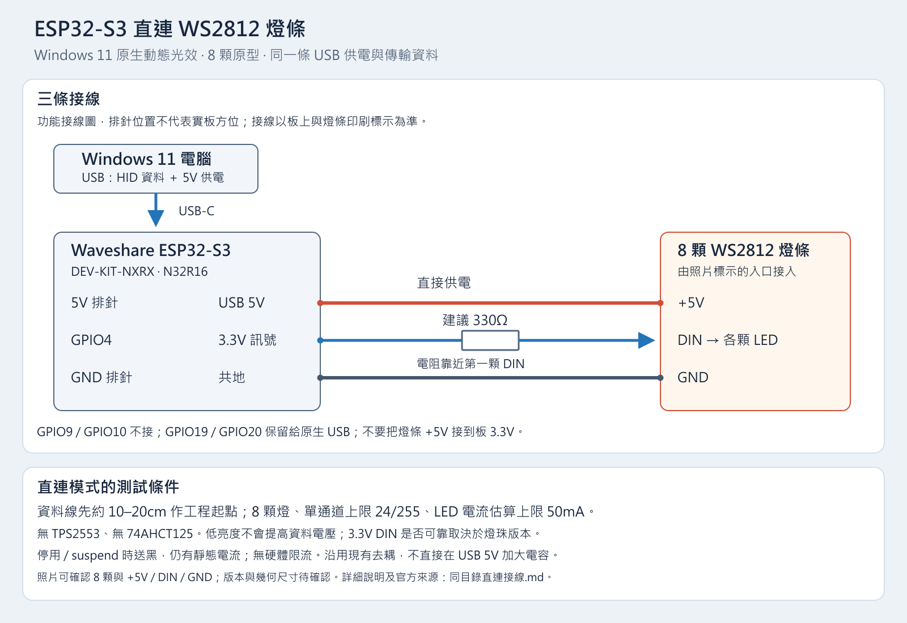

# ESP32 S3 直連 WS2812 燈條

目前原型使用同一條 USB 線供電及傳輸 Windows 11 動態光效資料，ESP32-S3 的 GPIO4 直接控制照片中的 8 顆燈條。依使用者要求，先省略 TPS2553 與 74AHCT125；GPIO9、GPIO10 不接。

## 三條接線

先拔除 USB 再接線。照片 `圖片/61285.jpg` 的入口標示為 `+5V`、`DIN`、`GND`，箭頭由入口朝燈條末端。以實物印刷標示確認接點，不單憑線色判斷。

| ESP32 S3 開發板 | 燈條入口 | 說明 |
| --- | --- | --- |
| 5V 排針 | +5V | 由 USB 經開發板供電。不要接到 3.3V 排針。 |
| GND 排針 | GND | 資料與電源共用接地。 |
| GPIO4 | DIN | 建議串聯 330Ω 電阻，置於靠近第一顆 DIN 的位置。 |

資料線先以約 10–20cm 作為工程起點，將 GND 線與資料線相鄰佈放。這個長度是本原型的測試起點，並非燈條規格保證。GPIO19、GPIO20 保留給原生 USB；DIN 不接燈條另一端的 DO／DOUT。

現階段使用成品燈條現有去耦，**不要在板 5V／USB VBUS 直接另加 100µF 或 1000µF 大電容**。沒有電源開關時，新增大電容的浪湧可能造成 USB 壓降或重新枚舉；若量測後確需補電容，應再設計充電控制。[TI USB 電源應用說明](https://www.ti.com/lit/an/slva049/slva049.pdf)

## 3.3V 資料訊號的適用範圍

ESP32-S3 輸出約 3.3V 邏輯，能否可靠控制 5V 供電的燈條，取決於實際燈珠版本。Worldsemi 官方指出 WS2812B-V6 的訊號門檻為 0.6VDD，可在 5V 供電下接受 3.3V 控制；舊型或其他相容品可能有較高門檻。照片沒有足以確認版本的標示，不能將 V6 的規格直接套用到這條燈。[Worldsemi V6 升級公告](https://www.world-semi.com/web/index.php?classid=19&id=587&lanstr=en&topclassid=19)

因此先以短線、少量燈珠測試直連。若出現隨機閃爍、顏色錯誤或不亮，先檢查共地、入口方向、資料時序與供電；仍不穩定時再考慮電平轉換。**低亮度可減少耗電，不能提高 DIN 的邏輯電壓，也不能保證電平相容。**[Adafruit 邏輯電平說明](https://learn.adafruit.com/adafruit-neopixel-uberguide/logic-level)、[串聯電阻建議](https://learn.adafruit.com/adafruit-neopixel-uberguide/best-practices)

## 亮度與 USB 供電

第一版保留 8 顆燈、RGB 單通道上限 24/255，以及 LED 支路估算電流上限 50mA。估算假設每顆靜態 1mA、各色彩通道全量 20mA；超出預算時降低整幀數值。這個模型是軟體估算，沒有感測實際電流，也沒有硬體限流，不能限制短路或未知燈珠的異常耗電。

Windows 亮度設為 100% 時，韌體仍保留上述上限。USB 電流還包含 ESP32-S3、CH334、CH343、穩壓器及板載 LED，因此燈條的 50mA 估算不等於整板 50mA。實際 USB 預算須結合 Hub 描述元與量測確認，不能由 USB-C 接頭或 HID 的 100mA 宣告推定。[TI Hub 電源說明，§9.1](https://www.ti.com/lit/ds/symlink/tusb2046b.pdf)

上電初始化、Windows 停用裝置控制、USB suspend 時，直連模式只送出全黑資料。燈條仍連著 5V，存在靜態電流；沒有實際斷電、過流關斷及電源故障回報功能。全黑不代表整板符合 USB suspend 耗電要求。[USB-IF suspend 電流規則](https://compliance.usb.org/index.asp?UpdateFile=Electrical)

## 先完成的實板測試

1. 確認 Windows 裝置管理員看到原生 HID，並在「設定 → 個人化 → 動態光效」看到燈條。
2. 先測全黑與低亮度紅、綠、藍，確認色序及 8 顆均可控制，再測 Windows 動畫。
3. 量測 USB 總電流及燈條端電壓，觀察全白、拔插、suspend／恢復時是否閃爍或斷線。

照片可確認 8 顆 LED 與入口接點，無法確定晶片版本、精確燈距及燈條寬度。程式中的幾何設定需在量測後調整；Windows 辨識、光效表現與電源耗電分別記錄驗證結果。

若之後需要受控供電與電平轉換，可參考保留的 [TPS2553 與 74AHCT125 電路](電路與供電.md)。目前直連原型不需要接這些零件。
