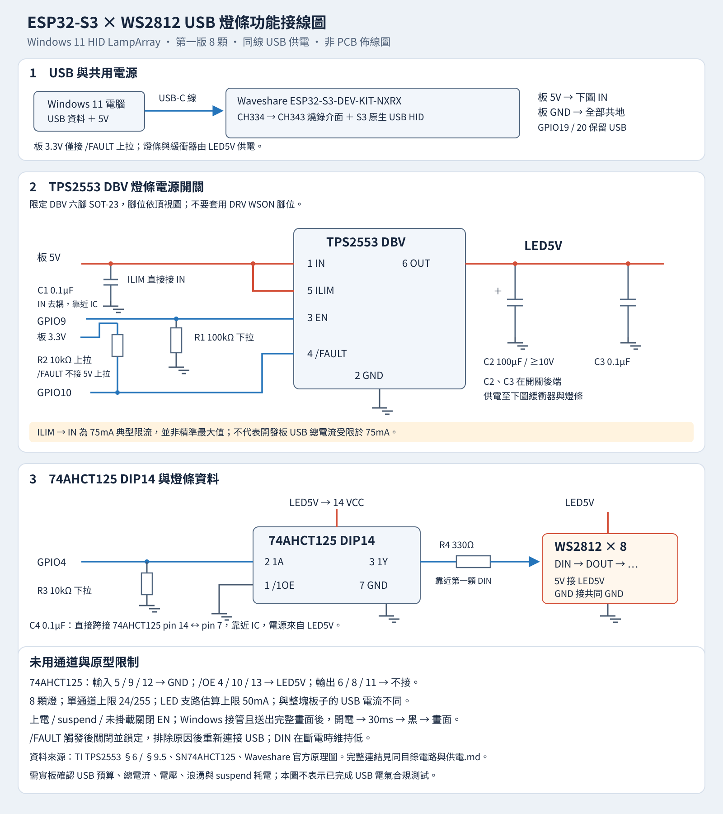

# ESP32 S3 USB 燈條電路與供電

**目前依使用者要求改採直連原型**，不接 TPS2553 與 74AHCT125，接線請使用 [直連接線](直連接線.md)。以下保留原先受控供電與電平轉換方案，作為日後擴充參考。

本原型使用照片中的 Waveshare ESP32-S3-DEV-KIT-NXRX N32R16，以同一條 USB 線傳輸 Windows 11 HID LampArray 資料並供電。外接燈條先採 8 顆 WS2812，資料腳使用 GPIO4。燈條經受控電源開關供電；軟體以低亮度及估算電流限制開始驗證。燈數與可用亮度須依實板耗電定案。

`圖片/61285.jpg` 可見 8 顆 LED，接線入口標為 +5V、DIN、GND，箭頭由入口往燈條末端。照片未提供尺寸刻度或晶片版本，仍須量測燈距及確認 LED 型號；接線以印刷標示為準。

此圖為功能接線圖，沒有定義 PCB 封裝方向與佈線。焊接前請按 IC 的頂視圖確認第 1 腳；TPS2553 的 DBV 與 DRV 封裝腳位不同。

## 原型材料

| 材料 | 數量 | 規格與用途 |
| --- | --- | --- |
| ESP32-S3 開發板 | 1 | 使用專案照片中的 Waveshare 板。 |
| WS2812 燈條 | 暫定 8 顆 | 5V RGB；實際版本、燈距與顆數需確認。 |
| SN74AHCT125N | 1 | DIP14，3.3V 至 5V 資料緩衝。 |
| TPS2553 DBV 與轉接板 | 各 1 | 六腳 SOT-23；須能接 EN、FAULT 與 ILIM。 |
| 330Ω 電阻 | 1 | DIN 串聯電阻。 |
| 10kΩ 電阻 | 2 | GPIO4 下拉及 /FAULT 上拉。 |
| 100kΩ 電阻 | 1 | EN 下拉。 |
| 0.1µF 陶瓷電容 | 3 | C1、C3、C4，至少 10V。 |
| 100µF 電解電容 | 1 | C2，至少 10V，注意極性。 |
| USB 資料線、排針與連接線 | 依組裝 | USB 線需支援資料傳輸；電源及 GND 線保持短。 |

## USB 與開發板

這系列板子的 USB-C 經 CH334 集線器連到 CH343 UART 與 ESP32-S3 原生 USB；韌體以原生 USB 枚舉 HID，CH343 可保留燒錄及日誌用途。GPIO19 與 GPIO20 留給 USB，外接燈條不使用這兩腳。系列原理圖的板載 RGB 為 GPIO38。N32R16V 的 GPIO47 與 GPIO48 屬於 1.8V 電源域，亦避開使用。照片標示 N32R16，實際記憶體容量與硬體修訂需連線確認。[Waveshare 系列說明](https://docs.waveshare.com/ESP32-S3-DEV-KIT-N8R8)、[官方 FAQ](https://docs.waveshare.com/ESP32-S3-DEV-KIT-N8R8/FAQ)、[系列原理圖](https://files.waveshare.com/upload/e/e1/ESP32-S3-DEV-KIT-N8R8-schematic.pdf)

## TPS2553 燈條電源支路

採用 **TPS2553 DBV 六腳 SOT-23**，不是 TPS2552，也不是 DRV WSON 封裝。EN 為高有效。以下 `板 5V`、`板 3.3V` 皆指開發板排針；`LED5V` 是 TPS2553 的受控輸出。

| TPS2553 DBV 腳位 | 接線 |
| --- | --- |
| 1 IN | 接板 5V。C1 0.1µF 陶瓷電容接 IN 與 GND，靠近 IC。 |
| 2 GND | 接共同 GND。 |
| 3 EN | 接 GPIO9；另以 R1 100kΩ 下拉至 GND，令上電預設關閉。 |
| 4 /FAULT | 接 GPIO10；R2 10kΩ 上拉到板 3.3V，不能上拉到 5V。 |
| 5 ILIM | 直接接 pin 1 IN，不接 GND。此接法的限流值為 75mA 典型。 |
| 6 OUT | 形成 LED5V，供燈條及 74AHCT125 使用。 |

`ILIM → IN` 是資料表允許的低電流配置；**75mA 是典型值，不是保證精準的最大電流，也不代表整塊板子的 USB 電流上限**。這個低電流配置對輸入雜訊較敏感，C1 與短接線很重要。實測若需追加輸入陶瓷電容，必須一併檢查 USB 上電浪湧。[TI TPS2553 資料表，§6、§9.5](https://www.ti.com/lit/ds/symlink/tps2553.pdf)

C2 100µF 電解電容及 C3 0.1µF 陶瓷電容接 **LED5V 與 GND**，置於開關後端並靠近燈條入口；C2 正極接 LED5V，負極接 GND，耐壓至少 10V。74AHCT125 另以 C4 0.1µF 陶瓷電容接 pin 14 與 pin 7，靠近 IC。C1 是開關前必要的輸入去耦，C2、C3、C4 都在受控輸出端。

不把一般燈條接線常見的 1000µF 直接接到 USB VBUS。大電容需由開關控制充電；本配置的 100µF 仍須量測啟動時間、浪湧與 /FAULT，30ms 等待時間不代替電源量測。[TI USB 電源應用說明](https://www.ti.com/lit/an/slva049/slva049.pdf)

## 74AHCT125 與資料線

採用 **74AHCT125 DIP14**。AHCT 的 TTL 輸入可接受 ESP32-S3 的 3.3V 資料，再輸出接近 LED5V 的訊號；VCC 正常工作範圍為 4.5–5.5V，應量測燈條端及緩衝器端電壓。[TI SN74AHCT125 資料表](https://www.ti.com/lit/ds/symlink/sn74ahct125.pdf)

| 74AHCT125 DIP14 腳位 | 接線 |
| --- | --- |
| 14 VCC | 接 LED5V。 |
| 7 GND | 接共同 GND。 |
| 1 /1OE | 接 GND，第一通道啟用。 |
| 2 1A | 接 GPIO4；R3 10kΩ 由此點下拉至 GND。 |
| 3 1Y | 經 R4 330Ω 串聯電阻接第一顆 WS2812 DIN。 |
| 5、9、12 未用輸入 | 接 GND，避免懸空。 |
| 4、10、13 未用 /OE | 接 LED5V，關閉未用通道。 |
| 6、8、11 未用輸出 | 不接。 |

R4 靠近第一顆燈的 DIN。燈條的 5V 接 LED5V，GND 接共同 GND，各顆 DOUT 依序接下一顆 DIN。不要把燈條電源接到板 3.3V；先確認燈條上的箭頭方向。若使用裸顆 WS2812，應依實際型號資料表補齊每顆去耦；成品燈條需確認已具去耦。[Adafruit NeoPixel 接線建議](https://learn.adafruit.com/adafruit-neopixel-uberguide/best-practices)

## 電源與故障控制

韌體採以下時序；GPIO4 在燈條斷電期間保持低電位，避免由 DIN 供電。

1. 上電令 GPIO9 低、GPIO4 低，燈條不供電。
2. 原生 USB 已掛載且未 suspend，並且 Windows 已關閉 AutonomousMode、送出一筆有效的完整畫面後，才令 GPIO9 高。
3. 等待 30ms，先送全黑，再送經亮度與電流限制處理的畫面。
4. USB suspend、unmount 或回到自主模式時，關閉燈條支路。
5. /FAULT 觸發後鎖定關閉；排除原因並重新連接 USB 才恢復。TPS2553 本體是恆流限制型，這個鎖定動作由韌體完成，不能和硬體鎖斷型 TPS2553-1 混淆。

GPIO9 的硬體下拉提供預設關閉，但韌體控制仍需實板驗證。關閉輸出不會立即放完 C2 的電，重新上電與 DIN 時序應以量測確認。

## USB 電流預算

第一版採 8 顆燈、RGB 單通道上限 24/255，以及 LED 支路估算上限 50mA。估算模型保守假設每顆靜態 1mA、每個色彩通道全量 20mA；若超出預算，整幀等比例降低。這只是軟體估算，不是電流感測器，不同 WS2812 版本的實際耗電須量測。

使用傳統 USB 2.0 預算時，配置前為 100mA；bus-powered Hub 的下游每埠通常只能提供 100mA，Hub 與下游裝置合計不能超過 500mA。實板 CH334 的電源模式、描述元及總耗電需讀回確認；HID 描述元宣告 100mA 不代表開發板加燈條合計已限制在 100mA，也不因使用 USB-C 連接器而取得 USB PD 大電流。[TI Hub 電流說明，§9.1](https://www.ti.com/lit/ds/symlink/tusb2046b.pdf)

USB suspend 時僅顯示黑色不足以消除 WS2812 靜態耗電，因此切斷燈條支路。USB-IF 的 suspend 電流規則仍適用於整個周邊；開發板上的 CH334、CH343、穩壓器及 ESP32-S3 合計耗電須另外量測。[USB-IF Electrical Updates，Maximum Suspend Current](https://compliance.usb.org/index.asp?UpdateFile=Electrical)

## 接線後驗證

先只接開發板與資料介面，確認 USB HID 及 Windows 動態光效辨識；接上燈條後先測單色與全黑，再測 Windows 全白、動畫與拔插。量測至少包含 USB 總電流、LED 支路電流、LED5V 穩態電壓與上電浪湧、/FAULT 是否誤觸發、suspend 及恢復時的耗電與畫面。Windows 辨識成功與電源電氣規範是不同驗證項目，兩者都通過後再增加燈數或亮度。
